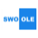

<h1 align="center">你好 👋，我是 Lee </h1>

  
  
  

- 💹 关注**加密交易所、金融科技与 AI 工具实践**
- 🧩 具备交易系统与产品落地经验，熟悉现货 / 合约 / 撮合 / 清算 / 行情 / U卡
- ✍️ 持续记录技术实践、产品思考与行业调研
- 🌐 博客：[www.tago.top](https://www.tago.top)

## 🛠️ 技能树

### 📝 编程语言

  

### ⚙️ 后端 & 框架

  &nbsp;
  
  

### 🗄️ 数据库

  &nbsp;
  
  

### 📨 消息队列

  &nbsp;
  

### 🌐 网络协议

  
  
  
  

### 🔐 安全

  
  
  
  

### ☁️ DevOps & 工具

  

### 🤖 AI 开发

  
  
  

